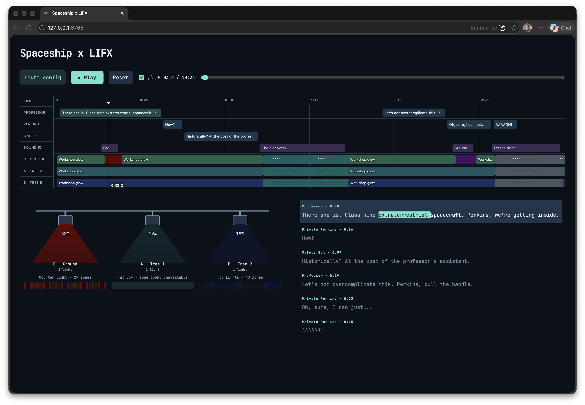

# Spaceship-LIFX

A local Halloween spaceship show with synchronized dialogue, sound effects, and LIFX lighting. Follow the Professor, Private Perkins, and Unit-7 as they try to open an extraterrestrial spacecraft.



## Get started

Clone this repository or [download a release ZIP](https://github.com/chanbert/Spaceship-LIFX/releases/latest). Both platforms use the same app and included audio. Extract the entire ZIP before running it.

| Platform | Double-click launcher | Terminal alternative |
| --- | --- | --- |
| Windows | `Start Web Player.bat` | `py -3 web_server.py` |
| macOS | `Start Web Player.command` | `python3 web_server.py` |

Requires Python **3.9 or newer** and a modern browser (Edge, Chrome, or Safari). If Python is missing, use your organization's approved software source. No `pip`, npm, API key, administrator privileges, or third-party Python packages are needed. The Windows launcher tries `py -3`, then `python`, and displays guidance if neither works.

For a clone:

```sh
git clone https://github.com/chanbert/Spaceship-LIFX.git
cd Spaceship-LIFX
```

Run the command for your platform from the table above. Keep the server window open. The browser opens at **http://127.0.0.1:8765**. Press **Play** to preview the complete 10:23 show without lights. Choose your speaker in the operating system's sound settings.

If port 8765 is already occupied, close the other player or use `--port 8766`. `--no-browser` suppresses automatic browser opening. Press **Reset** before stopping the server with Ctrl+C.

### Using Copilot

After cloning, ask: “Read README.md and run Spaceship-LIFX on this machine. Use the installed Python 3.9+ interpreter; no package installation is necessary. Start in preview mode and do not enable real lights.”

### Windows networking

Discovery uses Windows PowerShell's built-in `Get-NetIPAddress` command to find local broadcast addresses, with limited broadcast as a fallback. It does not change PowerShell execution policy. If prompted by Windows Firewall, allow Python on your trusted private home network to use LIFX lights. Managed-device restrictions, VPN routing, and Wi-Fi client isolation can prevent discovery; audio preview still works. Follow your organization's policy rather than disabling firewall or endpoint protections.

Prevent system sleep during a show. The Mac launcher handles idle sleep; on Windows, configure sleep through your usual approved settings. Use **Reset** while the server is still running to restore lights; forcibly closing the console or shutting down the PC cannot guarantee restoration.

## Connect your lights

Open **Light config**, click **Rescan network**, then drag discovered lights into **Ground**, **Tree 1**, or **Tree 2**. You can also click a light and then its destination. Multiple fixtures can share a role; available lights remain unused.


Keep the Mac and LIFX lights on the same local network, with local-network access allowed. Set a brightness cap and adjust light delay for your speaker; a positive delay moves lighting later. Click **Enable selected lights**, then **Play**. Only assigned fixtures receive show commands. The on-screen lighting is an estimated preview, not device feedback.

Click timeline cues or dialogue words to seek. **Reset** stops playback and restores captured light state. The server also attempts restoration after eight seconds without a browser heartbeat or on shutdown. Leave the server running until restoration completes. Fixtures that do not respond during startup are skipped when other assigned fixtures are reachable.

## Privacy and local data

Fresh installs contain no saved devices or assignments. The main screenshot illustrates an example configured rig; its display names are not shipped as app configuration. Discovery creates `lights.json` locally (device IDs, names, network addresses, and discovery metadata). Role choices are stored in `light-assignments.json`. Both files, temporary assignments, and `.env` files are ignored by Git. Do not attach these files when sharing a copy or reporting an issue.

The server listens only on loopback. Playback needs no cloud service, account, API key, or internet connection. LIFX control uses local UDP. This repository includes the finished show, not private generation credentials, voice-production caches, earlier experiments, or the original installation's device data.

## Development

- `web/`: browser player, timeline, dialogue, and light visualization.
- `web_server.py`: local HTTP server and lighting scheduler.
- `lifx.py`: LIFX LAN discovery, commands, and state restoration.
- `editions/ship-wouldnt-open/`: finished audio, script, cue sheet, and aligned words.

Run the hardware-independent checks:

```sh
python3 -m unittest discover -v
```

GitHub Actions runs the tests on Windows and macOS using preinstalled Python. The suite starts the Windows batch launcher from a path containing spaces, checks HTTP/audio delivery and clean defaults, and validates adapter discovery. Tests use synthetic device IDs and mocked lighting commands. Real LIFX discovery, audio output, and restoration on a managed Windows laptop still require a hardware smoke test. The audio generation pipeline is not included; the finished WAV is ready to play.

## Credits

Dialogue and sound effects were generated with ElevenLabs. JetBrains Mono is bundled in the stylesheet under the [SIL Open Font License](docs/licenses/jetbrains-mono.txt). LIFX is a trademark of its owner; this is an independent project.
