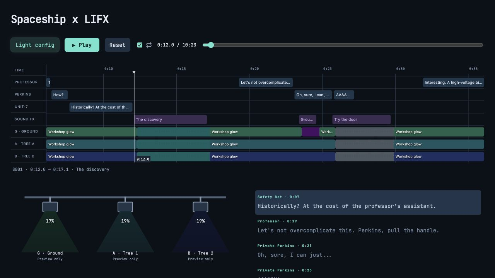
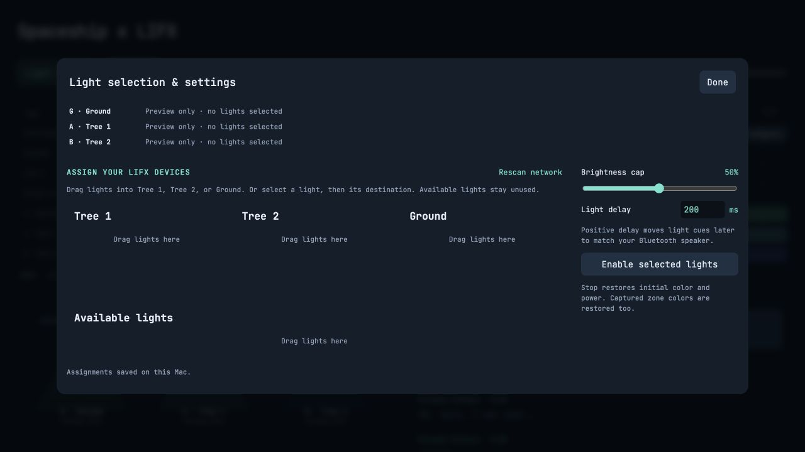

# Spaceship-LIFX

A local Halloween spaceship show with synchronized dialogue, sound effects, and LIFX lighting. Follow the Professor, Private Perkins, and Unit-7 as they try to open an extraterrestrial spacecraft.



## Get started

1. [Download the latest release](https://github.com/chanbert/Spaceship-LIFX/releases/latest) and unzip **Spaceship-LIFX-macOS.zip**.
2. On a Mac with Python 3.9 or newer, double-click **Start Web Player.command**. Keep its Terminal window open.
3. Open **http://127.0.0.1:8765** if the browser does not open automatically.
4. Press **Play** to preview the complete 10-minute, 23-second show. No lights or API keys are required.

Alternatively, from the extracted folder:

```sh
python3 web_server.py
```

Playback uses only Python's standard library and the included audio; there are no packages to install. macOS is the supported platform for LAN discovery and the launcher. A modern browser with WAV playback is required. Select your speaker in macOS Sound settings before starting.

## Connect your lights

Open **Light config**, click **Rescan network**, then drag discovered lights into **Ground**, **Tree 1**, or **Tree 2**. You can also click a light and then its destination. Multiple fixtures can share a role; available lights remain unused.



Keep the Mac and LIFX lights on the same local network, with local-network access allowed. Set a brightness cap and adjust light delay for your speaker; a positive delay moves lighting later. Click **Enable selected lights**, then **Play**. Only assigned fixtures receive show commands. The on-screen lighting is an estimated preview, not device feedback.

Click timeline cues or dialogue words to seek. **Reset** stops playback and restores captured light state. The server also attempts restoration after eight seconds without a browser heartbeat or on shutdown. Leave the server running until restoration completes. Fixtures that do not respond during startup are skipped when other assigned fixtures are reachable.

## Privacy and local data

Fresh installs contain no saved devices or assignments. Discovery creates `lights.json` locally (device IDs, names, network addresses, and discovery metadata). Role choices are stored in `light-assignments.json`. Both files, temporary assignments, and `.env` files are ignored by Git. Do not attach these files when sharing a copy or reporting an issue.

The server listens only on loopback. Playback needs no cloud service, account, API key, or internet connection. LIFX control uses local UDP. This repository includes the finished show, not private generation credentials, voice-production caches, earlier experiments, or the original installation's device data.

## Development

- `web/`: browser player, timeline, dialogue, and light visualization.
- `web_server.py`: local HTTP server and lighting scheduler.
- `lifx.py`: LIFX LAN discovery, commands, and state restoration.
- `editions/ship-wouldnt-open/`: finished audio, script, cue sheet, and aligned words.

Run the hardware-independent checks:

```sh
python3 -m unittest discover -v
```

Tests use synthetic device IDs and mocked lighting commands. The audio generation pipeline is not included; the finished WAV is ready to play.

## Credits

Dialogue and sound effects were generated with ElevenLabs. JetBrains Mono is bundled in the stylesheet under the [SIL Open Font License](docs/licenses/jetbrains-mono.txt). LIFX is a trademark of its owner; this is an independent project.
